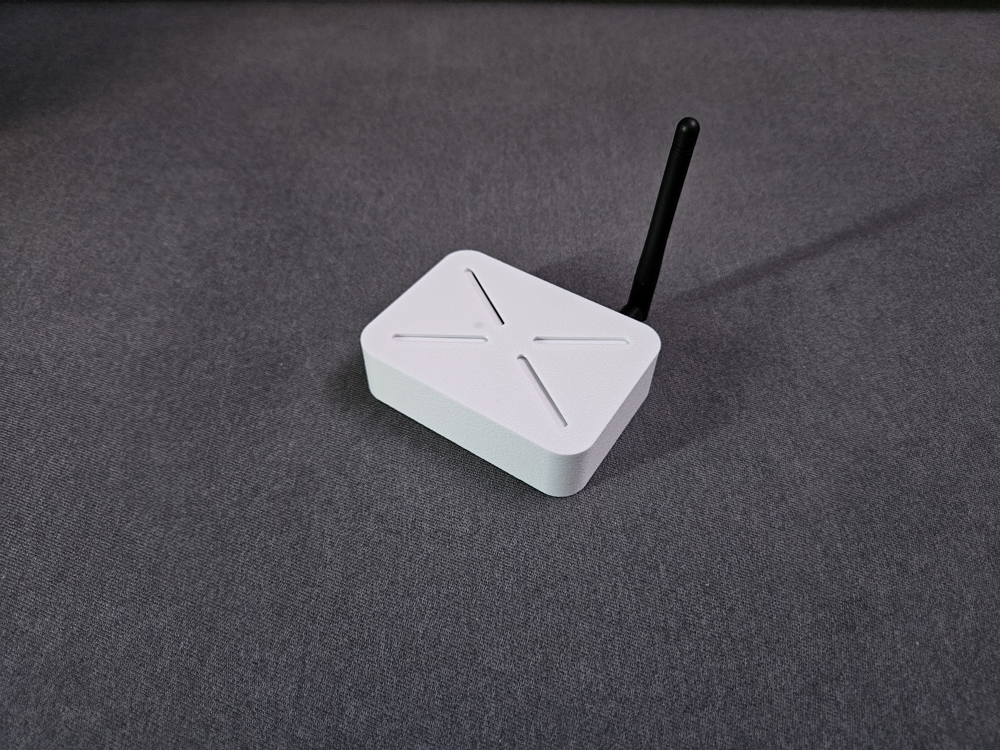
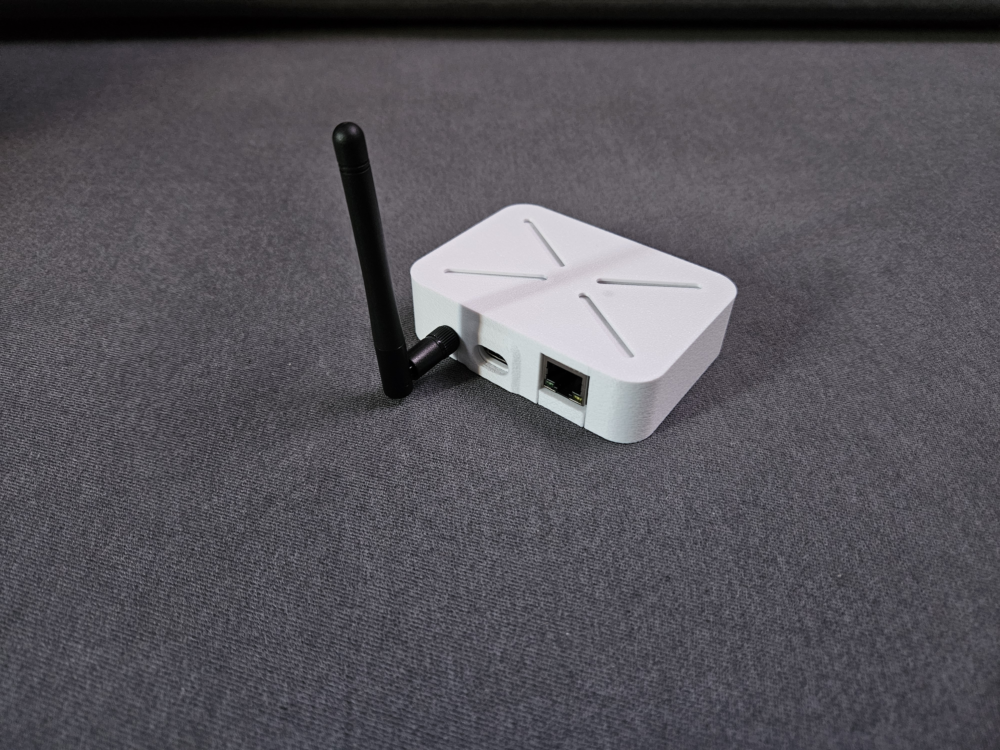
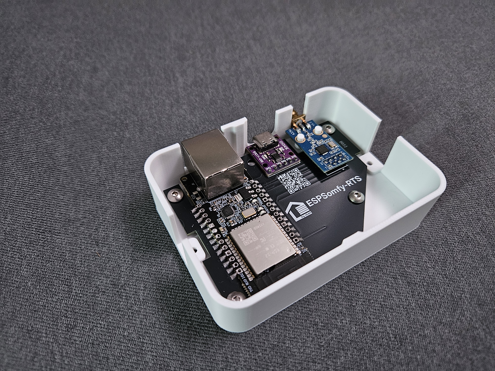

     

  

   
 
  

    Contrôlez et gérez facilement vos volets roulants, portails, portes de garage ou tout autre appareil utilisant le protocole RTS 433 MHz.
     
     
    <a href="https://github.com/xkain/ESPSomfy-RTS/blob/main/README.md"><strong>Full README in English 🇬🇧 »</strong></a>
     
    <a href="https://github.com/xkain/ESPSomfy-RTS/wiki"><strong>Explorer la documentation »</strong></a>
     
    <a href="https://github.com/xkain/ESPSomfy-RTS/issues">Signaler un bug</a>
    &middot;
    <a href="https://github.com/xkain/ESPSomfy-RTS/pulls">Demander une fonctionnalité</a>
  

 

  

## À propos du projet

**ESPSomfy-RTS** transforme un ESP32 et un module radio 433 MHz en passerelle pour vos équipements au protocole **Somfy RTS** : volets roulants, stores, portails, portes de garage. Les autres marques du groupe Somfy — SIMU, Teleco, BFT — en vendent également : leurs modèles **RTS** se pilotent de la même façon. Vos télécommandes d'origine continuent de fonctionner — l'appareil les écoute pour garder l'affichage synchronisé.

Ce dépôt est un **fork** du projet de [rstrouse](https://github.com/rstrouse/ESPSomfy-RTS). Les fondations radio sont les siennes ; ce qui change est au-dessus.

| | |
| --- | --- |
| **Capacité** | 30 équipements, 14 groupes, 14 pièces, 7 télécommandes liées par équipement |
| **Protocoles** | RTS, RTW, RTV/L, et moteurs filaires par module relais |
| **Langues** | français, anglais, allemand, espagnol |
| **Intégrations** | Home Assistant, MQTT avec auto-découverte, API REST |
| **Mises à jour** | depuis l'interface, téléchargées directement depuis GitHub |

#### Ce que ce fork apporte

* **Une interface repensée et réellement responsive.** Le téléphone n'est plus un écran de dépannage : c'est un poste de pilotage.
* **Multilingue**, interface traduite dans son intégralité.
* **Les assistants radio déroulés pas à pas.** Appairer un moteur, lier une télécommande, associer un équipement à un groupe : chaque étape est numérotée, expliquée, et ne demande qu'une seule chose à la fois — avec un **mode expert** qui regroupe tout sur une page une fois le geste acquis. Un assistant à part préconfigure les boîtiers prêts à l'emploi.
* **Un sélecteur de carte radio.** Les GPIO de votre module se choisissent dans une liste, qui couvre les ESP32 les plus courants.
* **Une sécurité durcie.** Les secrets ne quittent plus l'appareil, les tentatives répétées se heurtent à un garde-fou.
* **Une réinitialisation à deux niveaux** : le réseau et la sécurité, ou l'usine complète.
* **Un graphique en temps réel sur le balayage de fréquence**, pour voir la télécommande se détacher du bruit pendant la recherche, au lieu de n'en lire que le résultat.

Et bien plus encore...

#### Protocoles pris en charge
* **433 MHz RTx :** prise en charge complète des protocoles **RTS, RTW, RTV/L** et **433,92 MHz**.
* **Contraintes de fréquence :** vous pouvez mélanger les protocoles tant qu'ils restent dans la même plage de fréquence de base.
  > **Note :** vous ne pouvez pas faire fonctionner simultanément des moteurs 433,92 MHz et 433,42 MHz sur le même émetteur-récepteur radio.
* **IO Homecontrol :** non pris en charge nativement. La compatibilité peut toutefois être obtenue via le protocole **IO Remote**, en s'interfaçant avec une télécommande désossée.

#### Moteurs filaires (relais)
Pour les moteurs « nus », sans radio intégrée, le projet prend en charge les **configurations de modules relais**. Une fois configurés, ces moteurs se pilotent depuis l'interface exactement comme des appareils RTS ou RTW.

 

### Pourquoi ce projet existe-t-il ?

**ESPSomfy-RTS** est un projet puissant à la base, mais j'ai estimé qu'il avait besoin d'une touche plus moderne et localisée.

Étant français (et donc un grand amateur de pain et de fromage), j'ai trouvé lors de ma toute première utilisation que les explications étaient parfois confuses. Surtout, j'avais l'impression de devoir mettre des lunettes de soleil à chaque fois que j'ouvrais l'interface ! Ce fork est conçu pour vous éviter un aller-retour chez l'ophtalmo et quelques maux de tête linguistiques au passage.

Tout en conservant les **fondations ultra-solides** du projet original, j'ai entièrement repensé l'expérience utilisateur pour la rendre **véritablement responsive** : l'interface est tout aussi agréable à utiliser sur mobile et tablette que sur PC, et la navigation est enfin limpide pour les non-anglophones.

Ce projet vise à rendre la gestion de vos appareils RTS 433 MHz aussi belle que fonctionnelle.

 

## Migration & Mises à jour

#### Depuis le firmware de rstrouse

> [!WARNING]
> **Ne passez pas de la v2.4.6/v2.4.7 à ce fork par la page Firmware de l'interface rstrouse.** Cette voie n'est pas prise en charge : elle ne remplace qu'une moitié du système et laisse une interface et un firmware qui ne se comprennent pas. Faites une installation complète par USB avec l'image « onboard » — voir le **[Guide d'installation](https://github.com/xkain/ESPSomfy-RTS/wiki/Guide-d'installation)**.

* **Vos données suivent.** Un fichier `.backup` du projet d'origine se restaure ici : équipements, groupes et adresses de télécommande sont reprises, et vos moteurs n'ont pas à être réappairés.
* **Sauf les GPIO radio.** Le sélecteur de carte introduit par ce fork ne peut pas les deviner depuis un fichier plus ancien : il faut les réassigner à la main dans l'onglet **Radio**.
* **Une alerte de compatibilité s'affiche** pendant la restauration. Elle est attendue et ne signale pas un échec.

#### Depuis une version antérieure de ce fork

* **La mise à jour depuis l'interface conserve votre configuration**, sans manipulation de votre part.
* **La sauvegarde automatique créée juste avant la mise à jour reste à l'ancien format.** Si vous rechargez ce fichier-là plus tard, vous retomberez sur l'alerte de compatibilité et sur la réassignation des GPIO.

> [!TIP]
> Après une mise à jour réussie, créez immédiatement une **nouvelle sauvegarde**. Elle contient la cartographie GPIO à jour et ne déclenchera plus aucun avertissement.

## Home Assistant

Deux intégrations fonctionnent avec ce firmware.

#### ESPSomfy-RTS Enhanced — recommandée

**[ESPSomfy-RTS Enhanced](https://github.com/xkain/ESPSomfy-RTS-enhanced)** est la version dédiée à ce fork : elle sait s'authentifier auprès d'un appareil protégé par un code PIN, affiche les notes de version du firmware au moment de la mise à jour, et expose les capteurs propres à cette lignée.

* **Installation :** directement dans le store **HACS** (*Home Assistant Community Store*), ou en cliquant sur le bouton ci-dessous.

#### ESPSomfy-RTS-HA de rstrouse — compatible, avec deux réserves

Si vous utilisez déjà l'intégration d'origine, vos entités, appareils et automatisations continuent de fonctionner normalement — à condition que vos entités gardent les mêmes identifiants. Deux limites à connaître :

* **Les notes de version du firmware ne s'affichent pas** dans Home Assistant : cette intégration n'a pas la fonction.
* **Une sécurité complète lui coupe l'accès, définitivement.** Toutes ses requêtes reçoivent un `401` et sa WebSocket est refusée : elle n'envoie pas de clé d'API, et elle apprend qu'il faut s'authentifier depuis une réponse qui est elle-même refusée. Elle ne peut donc pas s'en sortir seule.

> [!IMPORTANT]
> **Le mode « configuration seule » est ce qui fait la différence.** Il ne protège que les écrans de configuration et laisse ouvertes les routes dont une intégration a besoin : une sécurité active ne casse alors rien du tout.
>
> C'est le **réglage par défaut depuis la v2.6.0**, sur un appareil neuf ou réinitialisé. Une mise à jour, elle, conserve le réglage déjà enregistré : si votre appareil est plus ancien, vérifiez la case dans `Système` > `Sécurité` **avant** de poser un code PIN.
>
> Pour une protection complète, passez à ESPSomfy-RTS Enhanced **v2.6.0 ou plus récente** : elle sait s'authentifier.

## Feuille de route du projet ESPSomfy-RTS

Vous voulez savoir ce qui arrive ensuite, suivre l'avancement de la version en cours ou voir les fonctionnalités terminées ? J'utilise GitHub Projects pour maintenir une feuille de route en direct et à jour.

> 💡 **Cliquez sur le badge ci-dessus** pour suivre le développement en temps réel, les jalons en cours, et soumettre des fonctionnalités ou des corrections de bugs directement dans les colonnes du flux de travail.

 

## 🛠️ Dépannage & Réinitialisation d'usine

Si vous perdez l'accès à l'interface web (erreur de configuration réseau ou mot de passe oublié), une procédure de réinitialisation manuelle est disponible via des cycles d'alimentation (**Power Cycles**).

> [!IMPORTANT]
> La réinitialisation se fait **à deux niveaux**, pour ne pas vous obliger à tout perdre quand seul le réseau est en cause.

### Résumé des procédures

* **3 cycles d'alimentation :** réinitialise la configuration Wi-Fi et désactive les paramètres de sécurité. Vos équipements, groupes et pièces sont conservés.
* **6 cycles d'alimentation :** réinitialisation d'usine complète (**Full Wipe**).

### 📖 Documentation complète
Pour voir les instructions détaillées et les diagrammes de cycles, veuillez consulter la page dédiée :

👉 **[Voir la page de Factory Reset](https://github.com/xkain/ESPSomfy-RTS/wiki/Factory-Reset)**

> [!TIP]
> Utilisez toujours ces procédures en dernier recours. Si l'interface est toujours accessible, utilisez plutôt le bouton **Restaurer** dans les paramètres système.

---

## 📸 Captures d'écran

*Cliquez sur une capture pour l'ouvrir en pleine résolution.*

#### 📱 Mobile — mode sombre

  
  
  
  

#### 💻 Bureau — mode sombre

  
  
  

<b>✨ Voir les mêmes écrans en mode clair</b>

 

  
  
  
  

  
  
  

---

## 📚 Documentation & Ressources

La documentation de ce fork vit dans son **[wiki](https://github.com/xkain/ESPSomfy-RTS/wiki)**, en français : une page par écran de l'interface, à jour de la dernière version publiée.

* **[Guide d'installation](https://github.com/xkain/ESPSomfy-RTS/wiki/Guide-d'installation)** — flasher un ESP32 par USB depuis le navigateur, et arriver depuis le firmware de rstrouse.
* **[Tableau de bord](https://github.com/xkain/ESPSomfy-RTS/wiki/Tableau-de-bord)** — la visite de l'interface : cartes de groupe et d'équipement, boutons, témoins et fenêtres de positionnement.
* **[Équipements](https://github.com/xkain/ESPSomfy-RTS/wiki/EQUIPEMENTS)** et **[Groupes](https://github.com/xkain/ESPSomfy-RTS/wiki/GROUPES-(Groups))** — créer une fiche, chronométrer la course, appairer le moteur, lier vos télécommandes physiques.
* **[Configurer la Radio](https://github.com/xkain/ESPSomfy-RTS/wiki/Configurer-la-Radio)** — assignation des GPIO, accord de la fréquence, et un cas concret quand certains équipements ne répondent pas.
* **[Mettre à jour](https://github.com/xkain/ESPSomfy-RTS/wiki/Mettre-%C3%A0-jour)** — les trois fenêtres de mise à jour et les treize fichiers publiés par une *release*.
* **[Intégrations](https://github.com/xkain/ESPSomfy-RTS/wiki/Int%C3%A9grations)** — API REST, MQTT et Home Assistant.

---

## Crédits

Un merci tout particulier à l'auteur **[rstrouse](https://github.com/rstrouse)** pour son travail incroyable sur le projet original ESPSomfy-RTS.

### Contributeurs

Merci à ceux qui prennent le temps de faire avancer le projet :

  <a href="https://github.com/y-streibel-uiris">y-streibel-uiris</a>
  &middot;
  <a href="https://github.com/glich34">glich34</a>
  &middot;
  <a href="https://github.com/dirstel">dirstel</a>
  &middot;
  <a href="https://github.com/Peethiplatsch">Peethiplatsch</a>
  &middot;
  <a href="https://github.com/jcrespoc">jcrespoc</a>

---

## 📦 Boîtiers prêts à l'emploi (Plug & Play)

Si vous ne souhaitez pas fabriquer le matériel vous-même, je propose des **unités entièrement assemblées, flashées et testées individuellement** avant envoi. Elles sont prêtes à être alimentées pour piloter immédiatement vos équipements Somfy RTS 433 MHz.

🛒 **Disponibles à l'achat sur [Leboncoin](https://www.leboncoin.fr/profile/77a39e2a-ddb5-44c8-828a-954652c46ee7)**

### Deux éditions

| | **Édition Wi-Fi** | **Édition Ethernet & Wi-Fi** |
| --- | --- | --- |
| **Microcontrôleur** | ESP32 D1 Mini | ESP32 WT32-ETH01 |
| **Radio** | E07-M1101D-SMA (CC1101) | E07-M1101D-SMA (CC1101) |
| **Antenne** | 3 dBi amovible | 3 dBi amovible |
| **Réseau** | Wi-Fi | **Ethernet filaire** ou Wi-Fi |
| **PCB** | développé sur mesure | développé sur mesure |
| **Pont USB-série** | CP2102, présent sur la carte D1 Mini | module CH340N SOP8 soudé sur le PCB, le WT32-ETH01 n'en ayant pas |
| **Reflashage** | se branche et se flashe en USB-C, sans manipulation | bouton-poussoir en face inférieure pour passer en mode flash au branchement |

L'édition **Ethernet & Wi-Fi** s'adresse à ceux dont le boîtier doit être posé là où le Wi-Fi ne porte pas, ou qui préfèrent une liaison filaire pour une passerelle domotique. Le réseau se choisit dans l'interface : rien n'est figé au montage.

> [!CAUTION]
> **Soignez l'alimentation de l'édition Ethernet & Wi-Fi.** Le WT32-ETH01 supporte très mal les micro-coupures et les sous-tensions, au risque d'être dégradé **de façon permanente**. Utilisez un chargeur stable d'au moins **1,5 A** — un petit onduleur écarte le problème pour de bon. Pour l'édition Wi-Fi, un chargeur de téléphone d'au moins 1 A suffit.

> [!IMPORTANT]
> **💡 Note sur la configuration et l'assistant intégré**
>
> **L'assistant de préconfiguration automatique a déjà été exécuté par mes soins sur votre boîtier avant son expédition.** Votre appareil est donc configuré et prêt à l'emploi dès la première mise sous tension :
> * interface entièrement en **français** ;
> * fuseau horaire local configuré (**Europe/Paris**) ;
> * module radio **activé** et **GPIO spécifiques** à votre modèle déjà assignés.
>
> Pour retrouver toutes les caractéristiques et détails, une page dédiée aux **[boîtiers préassemblés](https://github.com/xkain/ESPSomfy-RTS/wiki/Bo%C3%AEtiers-pr%C3%A9assembl%C3%A9s)** est disponible.
>
> ⚠️ **En cas de perte de configuration :** si après une mise à jour majeure ou une réinitialisation d'usine vos équipements ne répondent plus, pas de panique — l'assistant reste disponible dans l'interface web.

 

  
  
  

  
  
  

